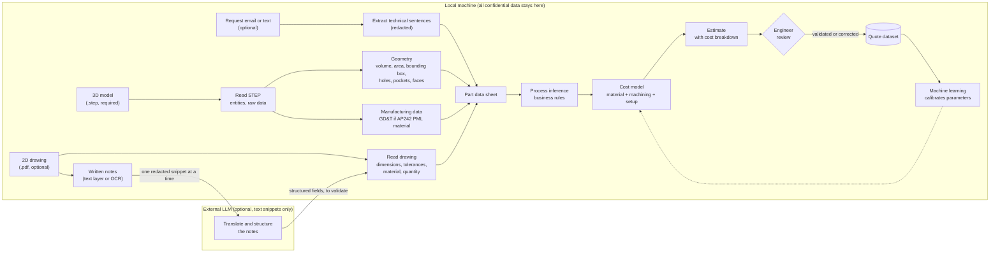

# StepQuote

A tool that imports a **STEP** file (ISO 10303, `.step` / `.stp`), reads its content, extracts the data of the part, and turns it into a **detailed cost estimate**: material, machining, setup, and finishing.

The goal is to automate the quoting that an engineer currently does by hand from a 3D model and a 2D drawing.

## How it works

1. **Input:** the 3D model (STEP) is required. The 2D drawing (PDF), its written notes, and any request email or text are optional. With the STEP file alone, the tool still works and reports the missing data instead of inventing it.
2. **Extraction:** the STEP file is read without losing data. Geometry (volume, holes, pockets) is computed. Tolerances and finishes come mainly from the drawing; the STEP file adds GD&T only when it carries semantic PMI (AP242). Material comes from the STEP file when present, otherwise from the drawing. Written notes on the drawing are read locally and, if enabled, translated and structured by an external LLM, which only receives short redacted snippets.
3. **Process inference:** business rules deduce the likely manufacturing methods (for example, a blind hole with an H7 tolerance from the drawing means drilling then reaming).
4. **Estimate:** a cost model combines material, machining time, setup and finishing, with every parameter visible.
5. **Review:** the engineer validates or corrects the estimate. Each decision becomes new training data.
6. **Learning:** a machine learning model improves the cost parameters from past quotes. It is added only once enough clean data exists.

## Data privacy: local by default

The 3D model, the drawing, the prices and the quote dataset are confidential. They stay on the local machine. An external LLM is optional, disabled by default, and receives only the technical part of a text, after redaction and an engineer's approval. Redaction reduces the risk but cannot guarantee that nothing leaks, so a fully local model remains the default option.

- [Architecture: data boundary](docs/ARCHITECTURE.md#data-boundary-local-vs-external)
- [Redaction of text sent outside](docs/REDACTION.md)

## Status

**Documentation phase.** No code has been written yet.

## Documentation

- [Idea and scope](docs/IDEA.md)
- [STEP format notes](docs/STEP_FORMAT.md)
- [Architecture and functions](docs/ARCHITECTURE.md)
- [Redaction of text sent outside](docs/REDACTION.md)
- [Roadmap](docs/ROADMAP.md)
