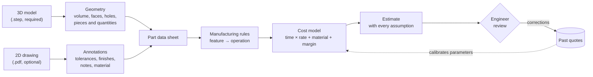

# StepQuote

Estimate the manufacturing cost of a part from its **STEP file** (the 3D model) and, when available, its **2D drawing**.

Today, a quote is made by hand: an engineer reads the model and the drawing, decides how the part would be made, and adds up the cost. StepQuote aims to do the measurable part automatically, and to show every assumption behind the rest.

**Status:** documentation only. No code is kept on `main`.

## How it works

1. **Read the STEP file.** Exact, checkable data: volume, surfaces, solid bodies, pieces and quantities from the assembly structure, units.
2. **Read the drawing,** if available. It supplies what the STEP file usually lacks: dimensional tolerances, surface finishes, notes, sometimes the material.
3. **Infer the manufacturing method** from the geometry, using explicit rules. Example: a cylindrical face through the part means a through hole, drilled; with an H7 tolerance from the drawing, it is drilled then reamed.
4. **Estimate the cost** from the shop's parameters: hourly rate, set-up time, time per operation, material price, margin. Every number is visible and editable.
5. **Review.** The engineer confirms or corrects. Past quotes calibrate the parameters later, when there is enough clean data.

## From geometry to manufacturing method

The file says what the part **is**, not how it will be made. A flat block and the same block with a drilled hole differ only by their features, and the cost follows from those features.

1. **Recognise features:** holes (cylindrical faces, with diameter and depth), pockets, steps, fillets, chamfers.
2. **Describe each feature:** dimensions, the direction it is machined from, through or blind.
3. **Group by set-up:** features reachable from the same direction are machined in one set-up.
4. **Map to operations with rules:** a deep hole becomes deep-hole drilling; a hole with an H7 tolerance (from the drawing) adds reaming.
5. **Price each operation** with the shop's parameters.

Steps 1 and 2 come from the geometry and can be checked. Steps 3 to 5 are rules written with the shop, so they give a typical method, not the only one. Feature recognition is reliable on simple prismatic parts. On complex parts (castings, free-form surfaces, many fillets), some faces stay unrecognised and must be flagged for the engineer.

## What is certain, and what is not

Each value has a status. The tool should always show which one applies.

| Status | Meaning | Examples |
|---|---|---|
| **Exact** | Read from the file | Solid count, units, face count, piece structure |
| **Computed** | Calculated by a geometry kernel, with a known uncertainty | Volume, surface area, bounding box |
| **Inferred** | Deduced by a rule, can be wrong | Hole or pocket recognition, manufacturing method |
| **Absent** | Not in the file, never invented | Tolerances, finishes, material, density |

Things that cannot be made certain:

- **Syntax** is formal and identical for every file. **Meaning** depends on the schema (AP203, AP214, AP242 and their editions) and on the CAD software that wrote the file.
- **Volume** on curved surfaces depends on the numerical method. On one test part, two settings differed by about 0.06 %.
- **A piece** is not always clear from the file. CAD systems store modelling bodies, which overlap and are not physical parts.
- **Manufacturing method** is a choice. The same part can be made in several valid ways.

## Key facts from the tests

- Solid bodies can overlap. Adding their volumes counts the overlap twice: fuse them first.
- A bounding box computed from all points is wrong: control points of curved surfaces can lie outside the part.
- An assembly file gives pieces and quantities through its product structure. A single product with several bodies is one piece.
- OpenCASCADE crashed when two XCAF documents were read in the same process. A batch job must use one process per file.

## Privacy

Drawings, prices and past quotes are confidential. They stay local by default.

An external language model may be used only to translate short written notes, after local redaction and approval by an engineer. It is off by default. The choice of provider is for the company to decide.

## Data

Sample STEP files are kept in `tests/fichiers_test/`, which is excluded from git. Use public test files, and check their licences.

## Next steps

1. Agree on the first part family and collect 5 to 10 past quotes for it, with their STEP files.
2. Rebuild the reader and the geometry extraction on a clean branch, with tests on public and generated files.
3. Recognise holes first, and measure detection on test parts with known features.
4. Build the cost model with editable parameters, and compare its estimates with the past quotes.

## Open decisions

- Which part families come first.
- Whether drawings are entered by hand or read automatically.
- Whether an external model is allowed for any text at all.
- Whether a machine-learning model is worth it, once there is enough labelled history.

## Earlier detailed notes

The longer notes (STEP format, methods, architecture, roadmap) were removed from `main` to keep this repository simple. They remain in the git history, at commit `3cd3619`.
