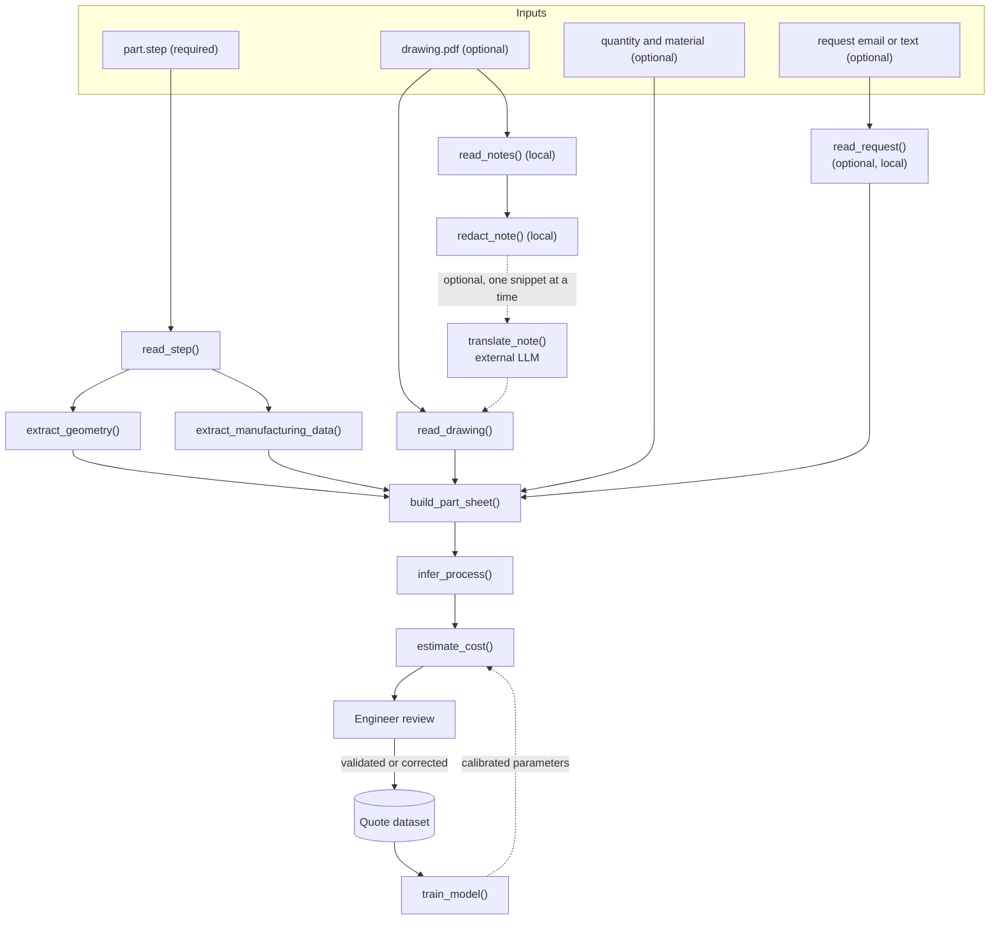

# Architecture

## Overview

## Planned functions

These functions are a plan, not yet implemented. Each one has one responsibility and a clear input and output.

| Stage | Function | Input | Output | Notes |
|-------|----------|-------|--------|-------|
| Read | `read_step(path)` | STEP file | `StepFile`: header, all entities, raw text kept | Lossless. No geometry calculation. |
| Read | `read_drawing(path)` | PDF drawing | `DrawingData`: dimensions, tolerances, notes, material, quantity | Manual entry first. Automatic reading later. |
| Read | `read_notes(path)` | PDF drawing | list of written notes (text layer, or OCR if needed) | Local only. |
| Read | `redact_note(text)` | one note | redacted note, with identifiers replaced by placeholders | Local only. Runs before any external call. |
| Read | `translate_note(redacted)` | one redacted note | fixed JSON fields (process, finish, tolerance, and so on) | **External, optional, off by default.** See the data boundary below. |
| Read | `read_request(text)` | request email or text | list of technical sentences | Local. Optional input. Redaction applies before any external use. |
| Extract | `extract_geometry(step)` | `StepFile` | `Geometry`: volume, area, bounding box, faces, holes, pockets | Uses OpenCASCADE or an own calculation. |
| Extract | `extract_manufacturing_data(step)` | `StepFile` | semantic GD&T and datums (AP242, only if present), material, density if present | Each value records its source. A missing tolerance is reported as "not in STEP", never as "none specified". |
| Merge | `build_part_sheet(...)` | outputs above, quantity | `PartSheet` | One record per part. |
| Infer | `infer_process(sheet)` | `PartSheet` | list of `Operation` (process, feature, parameters) | Explicit business rules. |
| Estimate | `estimate_cost(sheet, operations, params)` | sheet, operations, parameters | `CostEstimate` with breakdown per item | Every parameter visible and editable. |
| Review | engineer validation | `CostEstimate` | validated or corrected estimate | Human decision, always kept. |
| Learn | `record_correction(...)` | review result | row in the quote dataset | Stored locally. |
| Learn | `train_model(dataset)` | quote dataset | calibrated parameters | Added only when data is clean and sufficient. |

## Data boundary: local vs external

The 3D model, the drawing, prices and the quote dataset are confidential. The project separates what stays on the machine from what may leave it.

**Always local (never sent anywhere):**

- the STEP file and the PDF drawing, in full;
- geometry, part sheets, prices and the quote dataset;
- the cost parameters and the trained model;
- logs.

**External, optional and disabled by default:**

- only the text of **one written note at a time**, read from the drawing, after local redaction;
- never the file, an image, a page, the title block, a customer name, a company name, a part number, a price or a geometric value.

**Rules for the external call:**

1. **Off by default.** Enabled by an explicit setting in the configuration file (`external_llm: false`). Nothing is sent until the engineer turns it on.
2. **Redaction first.** `redact_note()` runs locally and replaces identifiers with placeholders before any call. It combines minimisation, rules, a local dictionary and local entity detection, then re-checks its own output. Any hit blocks the call. Details in [Redaction](REDACTION.md).
2b. **Preview and approval.** The engineer reads the exact redacted text and approves it before anything is sent.
3. **Minimum text.** The note is sent alone, with no context from the drawing. Notes are translated into a fixed vocabulary (for example, "ébavurer" becomes `deburring`).
4. **Fixed output schema.** The LLM must return a JSON object with known fields only. Any extra or malformed field is rejected.
5. **A suggestion, not a fact.** Results are stored as `llm_suggested`. The engineer validates them before they reach the quote dataset or the estimate.
6. **Audit log.** Every external call is recorded locally: time, redacted text sent, and fields returned. The log lets us check exactly what left the machine.
7. **Provider terms checked first.** Before enabling it, check the provider's data retention and training policies, and the company's data policy. The choice of provider is a decision for the company, not an assumption made in this project.

**Fully local alternative:** a language model running on a local machine behind the same `translate_note()` interface. Nothing leaves the machine. The cost is hardware and, usually, lower quality. This can replace the external call without changing the rest of the pipeline.

## Data flow

- Only the STEP file is required. Missing optional inputs (drawing, notes, request text, quantity) are recorded as missing in the part sheet. No value is invented to fill them.
- The reader keeps all data. Nothing is discarded at read time.
- Geometry, manufacturing data and drawing data are merged into a single `PartSheet`.
- Process inference and cost estimation work only from the `PartSheet`, never from the raw file.
- Each estimate keeps its breakdown, so the engineer can see where each cost comes from.

## Decisions

- **Language: Python.** The rest of the project (cost model, machine learning) is in Python.
- **Reader: own parser, standard library only.** It keeps the raw text of each entity. A verification step must confirm that reading reproduces the file without loss and without broken references.
- **OpenCASCADE (cadquery) is not a dependency of the reader.** It will serve as a reference in tests: the same numbers of faces and solids as read by OCC.
- **Machine learning comes after rules.** Business rules come first, because they are explainable and work without data. Learning calibrates their parameters once enough clean quotes exist.
- **If files become very large,** only the reader module is rewritten (for example in Rust).

## Parts and assemblies (method validated, code removed)

See [METHODS.md](METHODS.md) for the reasoning and limits behind each method.

A STEP file can hold one part with several bodies, or an assembly of several parts.

- **Pieces = leaf products.** Read `PRODUCT`, `PRODUCT_DEFINITION` and `NEXT_ASSEMBLY_USAGE_OCCURRENCE`. A product with no children is a physical piece. Its quantity is the number of occurrences in the assembly, multiplied through the levels.
- **Bodies are not pieces.** Several solids in one product (for example, SolidWorks feature bodies) belong to the same piece.
- **Volume per piece:** OpenCASCADE's XCAF document keeps the link between each occurrence, its piece and the piece's geometry. Solids inside a piece are fused before measuring, so overlaps are not counted twice.
  - Names come from the component labels. Internal references (`=>[0:1:1:3]`) are ignored.
  - Leaves without solids (wires or reference geometry) are skipped: they have no material.
  - **One XCAF document per process.** Reading two files in the same Python process crashes OpenCASCADE (access violation). Batch processing must run each file in its own process. `--json` exists for that.
  - Contacts and overlaps between different pieces are not checked yet.
- **Rebuilding one piece as its own STEP:** `export_piece()` writes the piece in its own coordinate frame. It does not keep the position it had in the assembly, and the file is rewritten by OpenCASCADE, so original names, colours or annotations may be lost. Checked: an exported box reads back at 6000 mm³.

## Volume and part breakdown (method validated, code removed)

- **Volume is computed by OpenCASCADE** (via cadquery). Surfaces such as B-splines, tori and cones have no simple closed-form volume, so a home-made calculation would be a large project of its own. The reader keeps the data; the kernel does the maths. This can be revisited later.
- **Solids can overlap.** The sum of solid volumes counts overlapping zones twice. The **material volume** is therefore the volume of the fused solids. Both values are reported.
- **Breakdown per solid:** volume, area, bounding box, face count per geometric type, and cylinder radii.
- **Identical solids** (same volume and bounding box) are probably copies of the same part, which matters for quantity and cost.

### How the manufacturing method is inferred: face signals

Face types are the first clue to how a part is made. These are signals, not proof: the rules in `infer_process()` must weigh them.

| Face type (OpenCASCADE) | Typical meaning | Manufacturing hint |
|-------------------------|-----------------|--------------------|
| `PLANE` | Flat face | Milling, sheet metal, sawing |
| `CYLINDER` | Hole or boss, with a radius | Drilling, boring, turning; the radius gives the hole size |
| `TORUS` | Fillet or round | Milling with a ball or radius cutter, or moulding |
| `CONE` | Chamfer, countersink, drill point | Chamfering, drilling |
| `SPHERE` | Ball end, spherical surface | Turning, or free-form machining |
| `BSPLINE` | Free-form surface | 5-axis machining, casting, forging, additive, or CNC milling with a lot of time |

A cylinder can be a hole (material inside) or a boss (material outside). Telling them apart needs the face orientation, which is a planned next step.

## Testing strategy (planned)

- **Round trip:** reading then writing back an entity must reproduce its text.
- **No broken references:** every `#id` used must exist.
- **Reference shapes:** simple parts with known values (for example, a 10 × 20 × 30 box has a volume of exactly 6000 mm³).
- **Cross-check with OpenCASCADE:** same face, edge and solid counts on the same files.

## Known pitfalls to handle

- 2D parametric points must be excluded from spatial calculations.
- Strings: `''` and `\X2\` escapes.
- Complex entities written on one line with several types.
- `$` and `*` must stay distinct.

## Open questions

- Python version and platform (Windows 11 for now).
- Acceptance of an OpenCASCADE dependency (installation can be difficult on Windows; conda is recommended).
- Interface: command line first, graphical interface later.
- Format of the quote dataset (CSV, SQLite, or other).
