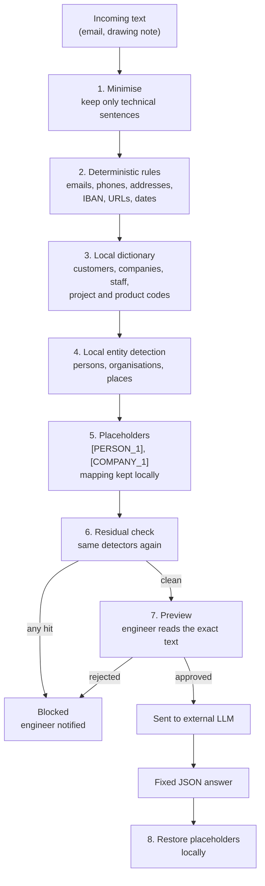

# Redaction of text sent outside the machine

## Scope

Some input is free text: a note read from a drawing, or a request arriving by email. Both are optional inputs: when none is provided, no text is processed and nothing is sent. Such text may contain names, companies, phone numbers, addresses, project references and dates. If an external LLM is enabled, only the **technical part** of the text may leave the machine, after redaction.

Redaction reduces the risk. It **cannot guarantee** that no identifier leaks, because free text can contain identifiers that no rule recognises. The design below is therefore built around three principles:

1. **Send less.** Only the text needed to understand the technical request.
2. **Remove what can be recognised,** with several independent methods.
3. **Fail closed.** If a check fails, nothing is sent. The engineer decides.

The strongest protection is still not to send the text at all. A local model is the default option (see [Architecture](ARCHITECTURE.md#data-boundary-local-vs-external)).

## Pipeline

## Steps in detail

### 1. Minimise

- Remove greetings, signatures, quoted replies, forwarded history, email headers, disclaimers and attachment names.
- Keep only the sentences that describe the part: material, finish, tolerance, thread, quantity, deadline if technical.
- The LLM never receives the full message, only these sentences.

### 2. Deterministic rules

Regular expressions for patterns that are easy to recognise: email addresses, phone numbers, postal codes with street names, bank details (IBAN), URLs, IP addresses, and exact dates.

Technical codes must **not** be removed blindly: `H7`, `M6`, `Ra 1.6`, `Ø8` are needed for process inference. A whitelist of standard technical vocabulary protects them. Anything else that looks like an internal reference is removed.

### 3. Local dictionary

A list, stored locally, of known customer names, company names, staff names, sites, and internal product or project codes. Matching is case-insensitive and includes common variants (with or without legal form, abbreviations).

The dictionary is maintained by the company. It is the most reliable method for known identifiers.

### 4. Local entity detection

A named-entity model that runs on the local machine detects persons, organisations and locations that the dictionary does not know. Candidates to evaluate (not yet tested): spaCy with a language model for the relevant language, and Microsoft Presidio, which is designed for personal-data detection and can run locally.

Each detector has a known error rate. Their results are combined, not trusted one by one.

### 5. Placeholders

Each identifier is replaced by a typed placeholder: `[PERSON_1]`, `[COMPANY_1]`, `[PLACE_1]`, `[REF_1]`. The same identifier always gets the same placeholder within a request.

The mapping (placeholder → original value) is kept **only on the local machine**, encrypted or in memory, and is deleted after use.

### 6. Residual check

After replacement, the detectors from steps 2 to 4 run again on the output. Any hit **blocks the call**. The check is fail-closed: an error during the check also blocks the call.

### 7. Preview and approval

The engineer sees the exact text that would leave the machine, with the placeholders visible, and must approve it. No text is sent without this approval. This is the main control: a human reads what leaves.

### 8. Restore

The LLM answers with a fixed JSON structure. Placeholders in the answer are replaced back with the original values **locally**, only for display in the local tool. The external service never sees the restored values.

## What is logged

- The redacted text that was sent (never the original).
- The number of hits per detector, for measuring the quality of the redaction.
- The time, and who approved the call.

The original text is never written to the external log.

## Measuring quality

Redaction must be measured, not assumed:

1. Build a **synthetic test corpus** of emails and notes, with identifiers planted on purpose (names, companies, phone numbers, references, addresses).
2. Run the pipeline on the corpus and count **leaks**: identifiers that remain in the output.
3. Count **over-removal**: technical terms wrongly removed (they break process inference).
4. Repeat after every change to the rules or the dictionary.

Before enabling any external call, the leak count on the corpus must be zero for each category of identifier, and the result must be recorded.

The synthetic corpus must not contain real customer data.

## What redaction does not solve

- An identifier that no rule, dictionary or model knows, for example a unique project nickname or a very specific machine description.
- Information that identifies a customer indirectly, through the combination of technical details.
- Images, scans and handwritten notes, which must be converted to text locally first and treated the same way.

These limits are the reason for the preview step and for the fully local option.

## Decisions for the company

- Whether an external LLM is allowed for text that contains customer communications at all.
- Which provider, under which contract and data-processing terms.
- Whether the local model is required for emails, and the external option only for drawing notes.
- Legal review of the processing of personal data contained in emails, before any use.

## Order of work

1. Build the synthetic corpus and the leak test.
2. Implement the deterministic rules and the whitelist of technical vocabulary.
3. Add the local dictionary.
4. Evaluate local entity detection and keep the best candidate.
5. Implement placeholders, the residual check, and the preview.
6. Measure, then decide whether any external call is enabled.
